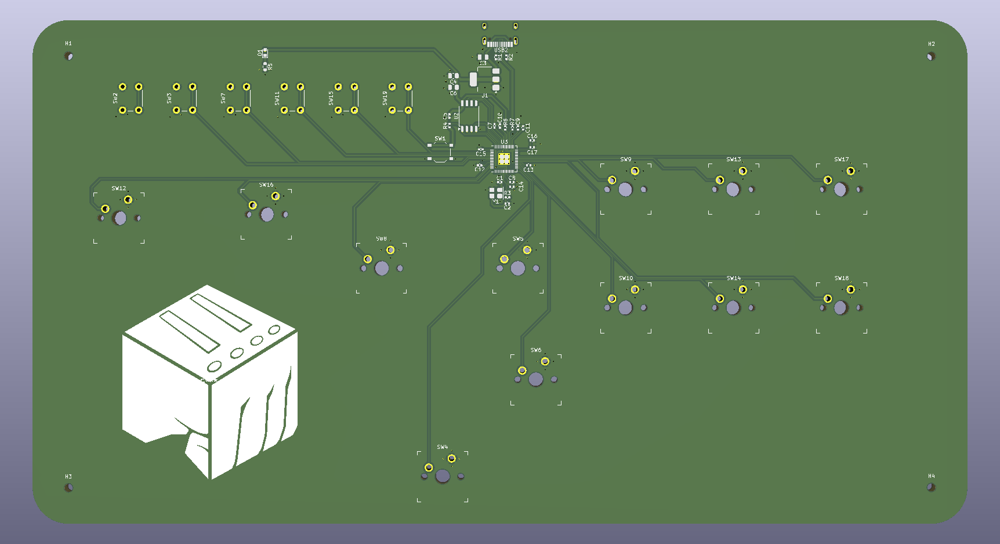
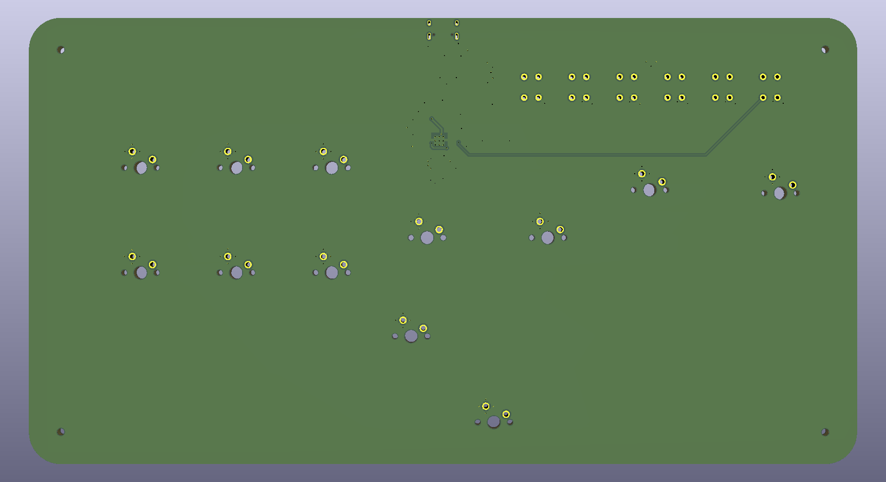

# FightKube
O FightKube é um controle no padrão hitbox desenvolvido para ser uma opção nacional, projetado para entregar um alto nível de desempenho, ergonomia otimizada para mãos de tamanho mediano e alto apelo comercial a um preço altamente competitivo.  

O projeto foi desenvolvido utilizando como componente principal o microcontrolador RP2040 para gerenciar as ações de entrada do controle com eficiência e baixo custo.
A placa de circuito impresso (PCB) foi projetada do zero através da ferramenta KiCAD, passando por revisões e alterações para minimizar os custos e atender aos padrões de mercado.

