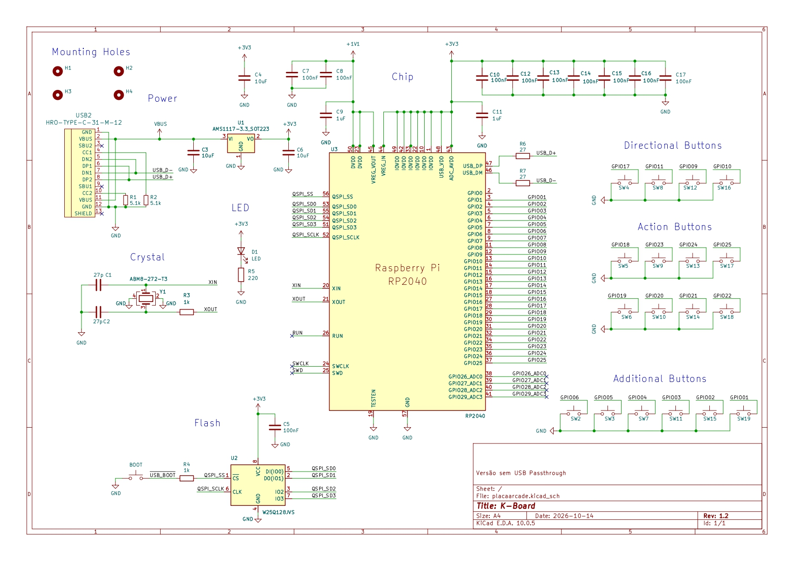

# FightKube
O FightKube é um controle no padrão hitbox desenvolvido para ser uma opção nacional, projetado para entregar um alto nível de desempenho, ergonomia otimizada para mãos de tamanho mediano e alto apelo comercial a um preço altamente competitivo.  

O projeto foi desenvolvido utilizando como componente principal o microcontrolador RP2040 para gerenciar as ações de entrada do controle com eficiência e baixo custo.
A placa de circuito impresso (PCB) foi projetada do zero através da ferramenta KiCAD, passando por revisões e alterações para minimizar os custos e atender aos padrões de mercado.

O nome FightKube nasce de um jogo de palavras que captura a essência do projeto. Fight, do inglês “luta”, remete aos jogos de luta, plataforma-alvo do projeto. Kube é uma estilização de cube, do inglês “cubo”, forma associada a ideia de caixa, no inglês “box”, interligando com o termo popular hitbox.

# Desenvolvimento da PCB
A PCB foi projetada através do KiCAD. Para isso, nossa equipe fez o levantamento de requisitos do projeto, e com base nisso escolhemos o controlador da placa, nesse caso o escolhido foi o microcontrolador RP2040. Para que o RP2040 funcione, alguns componentes são obrigatórios no projeto da placa, como: uma entrada USB para energia e dados; um conjunto de capacitores e resistores responsáveis por filtrar os sinais e evitar picos de energia; um regulador de tensão para realizar os ajustes necessários na tensão que chega no microcontrolador; uma memória Flash responsável por carregar o firmware 
do microcontrolador; um cristal oscilador para fornecer o sinal de clock do microcontrolador, garantindo as temporizações corretas; um botão para realizar a instalação do firmware na placa. 

# Produção
Para produzir a placa, nossa equipe utilizou os serviços de fabricação de placas de circuito impresso da empresa JLCPCB.
Para realizar um pedido é muito simples. O primeiro passo é adicionar os ficheiros Gerber localizados em [Gerbers](./PCB/rev1.1/KBoard.zip) no site da JLCPCB.
Após o envio dos arquivos, selecione as seguintes opções: 

1. Base Material: FR-4
2. Layers: 2
3. PCB Qty: Ao seu critério
4. Product Type: Industrial
5. Different Design: 1 
6. Delivery Format: Single PCB
7. PCB Thickness: 1.6mm
8. PCB Color: Ao seu critério
9. Surface Finish: HASL(with lead)
10. Via Covering: Plugged

Com todas as opções selecionadas, o próximo passo é enviar os arquivos BOM e CPL localizados em [BOM](./PCB/rev1.1/kBoardBOM.csv) e [CPL](./PCB/rev1.1/kBoardCPL.csv) respectivamente.

